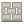

# Stone Layout Generator（石材割付ジェネレーター）

SketchUp 用の石材割付プラグインです。壁面を選んで自動割付し、**生成された目地を 3D ビュー上で直接つかんで動かせる**ことを最優先に作っています。

- 平面壁・折れ壁・R コーナー・丸柱を同じ割付エンジンで扱う（展開座標 `u, v`）
- 目地をドラッグすると、接している石だけが追従して再生成される
- 手動で調整した目地は、石厚・目地幅を変えても保持される
- 割付データは SketchUp ファイル内（AttributeDictionary）に保存され、再読み込み後も編集を継続できる

> ⚠ 現時点の幾何エンジンは Ruby 単体テストで検証済みですが、SketchUp 実機での動作確認はまだです。
> 実機で確認すべき手順は [docs/SKETCHUP_TEST_PLAN.md](docs/SKETCHUP_TEST_PLAN.md) にまとめています。

## インストール

### .rbz から（おすすめ）

1. `ruby tools/build_rbz.rb`（または `rake rbz`）で `dist/stone_layout_generator-<版>.rbz` を作る
2. SketchUp の 拡張機能 → Extension Manager →「拡張機能をインストール」で .rbz を選ぶ
3. ツールバー「石割付 Stone Layout」が表示される（表示されないときは 表示 → ツールバー で有効化）

### 開発版（ソースを直接置く）

`src/` の中身を SketchUp の Plugins フォルダへコピーします。

```
Plugins/
  stone_layout_generator.rb
  stone_layout_generator/
```

- Windows: `%APPDATA%\SketchUp\SketchUp 20XX\SketchUp\Plugins`
- macOS: `~/Library/Application Support/SketchUp 20XX/SketchUp/Plugins`

対象は SketchUp 2021 以降（Ruby 2.7 以上、`UI::HtmlDialog` 使用）を想定しています。

### ツールバー

| ボタン | 内容 | 使える条件 |
| --- | --- | --- |
|  石割付を生成 | 選択した壁面に割付を作る | 面を選択しているとき |
|  目地を編集 | 目地の直接編集モードに入る | 割付グループ（または石）を選択しているとき |
|  割付設定を変更 | 石厚・目地幅などを変更（目地位置は保持） | 同上 |

同じ操作は 拡張機能 → 石割付 Stone Layout メニューと右クリックメニューからも使えます。

## 使い方

1. 割付したい鉛直な面を選択する（隣り合う複数の壁や箱の側面 4 枚もまとめて選べる。R 面は 1 枚のファセットを選ぶと、柔らかいエッジでつながる面をまとめて認識）
2. ツールバーの「石割付を生成」ボタン（または右クリック →「石割付を生成...」）
3. 石幅・石高さ・目地幅・石厚などを入れると、目地のプレビューが表示される
4. 「生成」で石が作られ、そのまま目地編集モードに入る

### 目地編集モード

| 操作 | 内容 |
| --- | --- |
| クリック | 部分目地（石と石の間の 1 辺）を選択 |
| 編集パネルの「部分目地／通り目地」 | クリックで選ぶ単位を切り替え（通り目地＝同一直線上で連続する目地すべて） |
| Shift + クリック | いまのモードと逆の単位で選択（部分目地モードなら通り目地） |
| Ctrl（Mac: Option）+ クリック | 追加選択 |
| クリック → 動かす → クリック | 目地を移動（SketchUp の移動ツールと同じ）。変更される石が黄色、移動後の目地が緑で表示される（不正な位置は赤＋理由） |
| ドラッグ | 押したまま動かして離しても移動できる |
| スナップ | 既存の目地・壁端・壁中央に加えて、別のボリューム（壁・柱・サッシ・下絵など）の端点や線にも吸着（縦目地は鉛直な線、横目地は水平な線） |
| ドラッグ中に Alt（Mac: Command） | スナップを一時的に無効化 |
| 数値入力（VCB） | 選択した目地を指定量だけ移動（例: `100` / `-50`）。ドラッグ中は動かしている向きに適用 |
| Delete | 選択した目地を消して両側の石を結合（通り目地なら全部まとめて消す。1 回の元に戻すで戻る） |
| Esc | ドラッグを取り消し → もう一度で選択解除 |
| 右クリック | ここに縦目地／横目地を追加、角の近くなら「この角の納まり」（留め／左勝ち／右勝ち）、ロック／解除、通り目地モード切替、設定、整合性チェック |

編集パネルから石厚・目地幅の変更もできます（目地位置は保持）。
保存済みのファイルでは、割付グループを選んで右クリック →「石割付: 目地を編集」で編集を再開できます。

## 開発

```bash
rake test          # 幾何エンジン + SketchUp モックのテスト
```

```bash
ruby test/run_all.rb   # rake が無い環境
```

```bash
ruby bench/benchmark.rb   # 100 / 500 / 1000 / 5000 枚のベンチマーク
```

```bash
ruby tools/build_rbz.rb   # .rbz パッケージを dist/ に作成
```

```bash
python3 tools/make_icons.py   # ツールバーアイコン（SVG/PNG）を再生成（要 Pillow）
```

設計の詳細は [docs/ARCHITECTURE.md](docs/ARCHITECTURE.md)、実装状況・既知の課題は [docs/STATUS.md](docs/STATUS.md) を参照してください。
