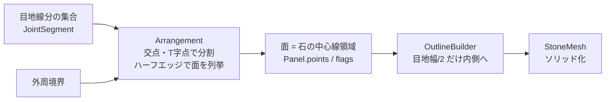
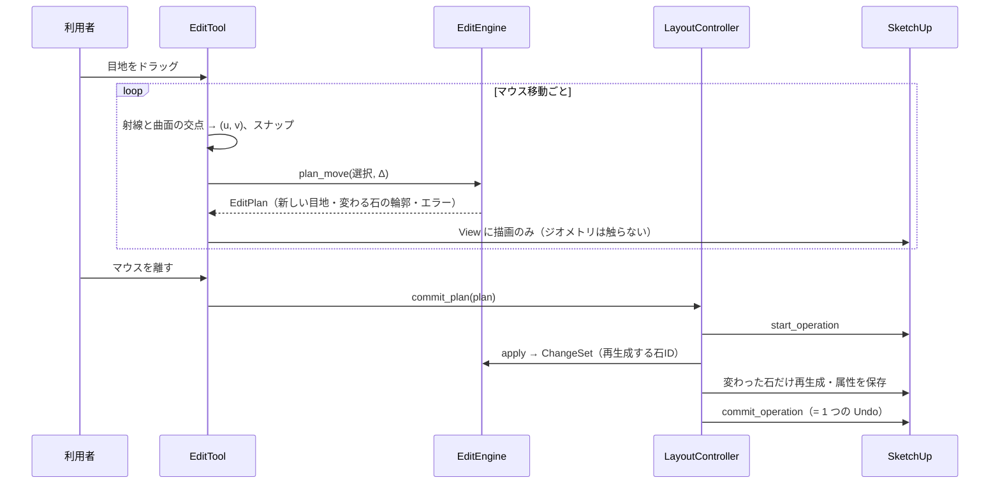

# アーキテクチャ

## 全体構成

```
src/
  stone_layout_generator.rb          拡張の登録（SketchupExtension）
  stone_layout_generator/
    main.rb                          メニュー・コマンド
    core.rb                          ↓ 純 Ruby の幾何エンジン（SketchUp 非依存・単体テスト対象）
    core/
      geometry/   Vec2, Geom2, Polygon, Arrangement(平面分割), SpatialGrid, PolygonOps
      surface/    Profile(直線+円弧の断面), ProfileBuilder(円弧推定), SurfaceDefinition
      layout/     Settings, JointSegment, AutoLayout, LayoutBuilder, LayoutDocument,
                  FaceExtractor, WorkingSet, EditEngine, EditPlan, Snapper
      panel/      Panel, OutlineBuilder(目地幅の差し引き)
      mesh/       Mesh, StoneMesh(台形分割によるソリッド生成), StoneGeometry
      persistence/Serializer(JSON・バージョン移行)
    sketchup/                        ↓ SketchUp API を使う層（薄く保つ）
      units.rb             inch ⇔ mm の変換はここだけ
      model_store.rb       AttributeDictionary への保存・読み込み
      face_reader.rb       選択面 → SurfaceDefinition
      geometry_builder.rb  Core::Mesh → 石グループ
      layout_controller.rb 1 つの割付グループの操作（Undo 単位・整合性）
      tools/edit_tool.rb   目地の直接編集（Sketchup::Tool）
      tools/preview_tool.rb
      ui/                  HtmlDialog（生成パネル・編集パネル）
```

依存は `sketchup/* → core/*` の一方向のみ。core は SketchUp を一切参照しません。

## 5 層の対応

| 仕様の層 | 実装 |
| --- | --- |
| Surface Definition | `SurfaceDefinition`（`Profile` + 展開座標の外周多角形） |
| Layout Graph | `LayoutDocument#segments`（目地中心線分の集合）＋ `Arrangement` による平面分割 |
| Panel Definition | `Panel`（永続 ID・表示番号・中心線領域・辺種別・状態） |
| Geometry Builder | `StoneGeometry` / `StoneMesh`（純 Ruby）→ `GeometryBuilder`（SketchUp） |
| Interaction Controller | `EditEngine`（純 Ruby の編集ロジック）→ `EditTool` / `LayoutController` |

## 展開座標系

```
P(u, v, s) = ( profile.offset_point(u, s), v )
```

- `u`: 水平断面に沿った累積距離（選択面＝基準面の弧長）
- `v`: 高さ
- `s`: 法線方向のオフセット（+ が外側）。法線は `N = T × Z`（壁を正面から見て u が左→右）

断面 `Profile` は `LineSegment2` と `ArcSegment2` の連続。円弧では `u` は基準半径の弧長なので、
石厚で内外面の周長が変わっても目地の割付は変わりません。折れ点ではオフセット線どうしの交点（マイター）を使います。
閉じた断面（丸柱）は周期 `L` の循環座標です。

## Layout Graph: 「目地線分の集合」を正規データにする

格子配列ではなく、**目地中心線の線分集合 + 外周境界** を正規データにし、石の領域はその平面分割（arrangement）として導きます。



- T 字・十字・L 字・凹形状の石は、線分の配置だけで自然に表現される（特別扱いがない）
- 石の辺（`Panel.points` の各辺）は平面分割の最小エッジ＝「部分目地」の単位
- 同一直線上で端点を共有する線分の連なり＝「通り目地」
- 各線分は `state`（auto / manual）と `locked` を持つ（AUTO / MANUAL / LOCKED）
- Half-Edge/DCEL を常時保持して手術的に更新する方式は採らず、局所的に平面分割をやり直す方式にした。
  位相の場合分け（十字点の分離、T 字の付け替えなど）が不要になり、壊れにくいことを優先

周期断面では線分を ±L ずらしたコピーを置いて平面分割し、「最小頂点が [0, L) にある面」を代表として採用します。
これで周回の継ぎ目を跨ぐ石も普通の石と同じに扱えます。

## 目地編集の処理方式

すべての編集は `plan_*`（文書を変更しない）→ `apply` の 2 段階です。ドラッグ中は毎フレーム `plan_move` を呼んでプレビューし、マウスを離したときだけ `apply` します。



### plan_move の中身（接続更新）

縦目地を Δ 動かす場合（横目地も同様）:

1. **部分移動**なら、選択辺を含む線分を「前・選択部分・後」に分割し、選択部分だけを動かす。**通り移動**なら同一直線上で連続する線分をすべて動かす。
2. 動かす線分の端点で、**同一直線上の目地がその先に続いている**場合は、旧位置と新位置をつなぐ短い目地（ジョグ）を足す。既存の目地と重なる部分は足さない。
3. 動かす線分の上に**端点を載せている目地（T 字）**は、その端点を Δ だけ動かして接続を保つ（伸縮）。十字点や丸柱の周回継ぎ目のように同一直線上で続いている点は端点として扱わない。
4. 本体を移動し、状態を MANUAL にする。
5. 変更した範囲 R の外接矩形に触れる石だけを集め、その範囲だけで平面分割をやり直す（**局所再計算**）。
6. 検証: 浮いた目地端、穴・孤立目地（面積保存）、石の数（移動なら不変）、最小寸法、目地幅を引いた輪郭の成立、切り離した石への影響。
7. 新しい面と旧い石を対応付けて ID を引き継ぐ（同形状 → 重なり面積の大きい順）。

```
部分移動（芋目地の十字点）            通り移動（馬踏みの横目地を上へ）

    │              │                     │       │         │       │
────┼────    →  ───┼──┐──               ─┴───┬───┴─   →   ─┴───┬───┴─   ← 横目地
    │                 │                      │                 │      下の縦目地は伸び
    │                 │                                               上の縦目地は縮む
  下段の縦目地だけ右へ。上段は動かず、
  横目地上の短い段差でつながる
```

石の追加（`plan_add`）は石の内部の弦として目地を足し、削除（`plan_delete`）は 2 枚の石が共有する辺をすべて取り除いて結合します。
どちらも同じ局所再計算・検証・ID 引き継ぎを通ります。

## 目地幅と石の実輪郭

内部では目地**中心線**だけを持ちます。石の実輪郭は `OutlineBuilder` が各辺を内側へオフセットして作ります。

- 縦目地の辺: `joint_v / 2`、横目地の辺: `joint_h / 2`、外周: `edge_clearance`（既定 0 ＝壁端に揃える）
- 同一直線上でオフセット量が違う辺の間には段差を入れる
- 結果が単純多角形・同じ向き・各辺が潰れていないことを検証（失敗したら確定前にエラー）

目地幅を変えても中心線は変わらないので、手動編集は保持されます。

## 石のソリッド生成（StoneMesh）

1. 石の輪郭の頂点 u、断面の要素境界、円弧の分割点（最大分割角・最大弦誤差）を「分割位置」にする
2. 分割位置の鉛直線で輪郭を帯に切り、各帯を台形に分解（台形の 4 隅は 2 本の鉛直線上 → 3D でも必ず平面）
3. 表面（`s_out`）・背面（`s_in`）・側面を作り、T 頂点が出ないように分割点を挿入
4. 円弧の分割点・石端の点は真円上の点。目地位置の計算に分割ポリゴンの弦長は使わない
5. 生成前に、オフセット後の半径（R が小さすぎないか）と、厚み方向の折り返し（出隅を跨ぐ短い石など）を検査
6. すべての辺がちょうど 2 面に逆向きで共有される（閉じたソリッド）ことを純 Ruby で検証

SketchUp 側（`GeometryBuilder`）はこのメッシュを `add_face` で面にし、法線の向きを合わせ、曲面の内部エッジを soft/smooth にするだけです。

## 角の納まり（CornerJoint）

折れ点に目地がある場合、角に接する石の端だけを上書きして納めます（目地の位置＝割付データは変えない）。

| 納まり | 角の手前（左）の石の端 | 角の先（右）の石の端 |
| --- | --- | --- |
| 留め `miter` | 角の二等分面を目地幅/2 だけ自分側へずらした面で切る | 同左（反対側へずらす） |
| 左勝ち `win_prev` | 相手の壁の表面まで伸ばす（出隅では小口が見える） | 勝ちの石の背面（出隅）／表面（入隅）から目地幅だけ離して止める |
| 右勝ち `win_next` | 負け（同上を左右反転） | 勝ち |

- 端の上書きは「石の端の u における表面・背面の xy 座標」として `StoneMesh` に渡す。端の面・上下の小口・表面・背面はいずれも平面のまま
- 全体の設定 `corner_mode` と角ごとの `corner_overrides` を持ち、角ごとの変更はその角に接する石だけ作り直す
- 端を動かした結果、石が裏返る（短すぎる）場合は生成前に拒否する

## 保存・Undo/Redo

- 割付グループの AttributeDictionary `Higeotoko_StoneLayout` に、`schema`・`revision`・`data`（JSON）を保存
- 石グループには `panel_id`・`layout_id`・形状シグネチャ（bbox）と、面積・体積などの属性
- 文書の更新・石の再生成・属性の保存を **1 つの operation** で行うので、SketchUp の Undo/Redo でデータと形状が常に一致する
- ツールは各イベントで保存側の `revision` を見て、Undo/Redo されていたら文書を読み直す
- 失敗時は `abort_operation` し、文書を属性から読み直す
- 読み込みに失敗しても形状には触らない（`PersistenceError` を表示するだけ）
- 形式変更に備え `Serializer::MIGRATIONS` で旧版からの移行を行う

## 通常の SketchUp 編集との関係

パラメトリック編集は専用ツールだけで行い、通常ツールでの変更は逆解析しません。

- 編集モード開始時に、石グループの欠落・形状シグネチャの不一致・データにない石グループを検出
- 「データから作り直す」か「変更された石を切り離す」を選べる
- 切り離した石（`Panel::DETACHED`）は再生成されず、それに接する目地の編集は拒否される

## 許容誤差と単位

- エンジンの長さはすべて mm（Float）。inch との変換は `sketchup/units.rb` だけ
- 同一点判定 `Tol::POINT = 0.001mm`、形状比較キーは 0.001mm で量子化
- SketchUp は約 0.0254mm 以内の頂点を統合するため、輪郭の最小辺長を `Tol::MIN_EDGE = 0.05mm` とする
